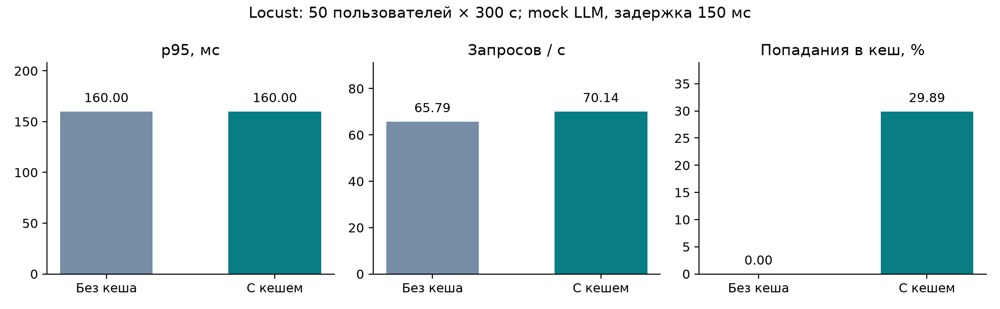
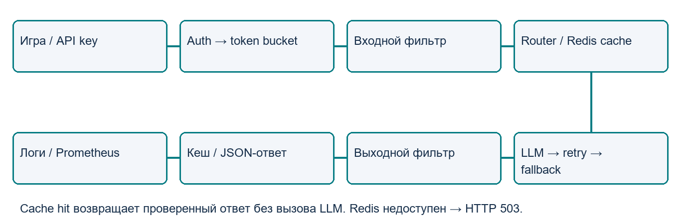

# Лабораторная работа № 9. Интеграция API LLM в игровой компонент

**Студент:** Печенов В. В. · **Группа:** ИВТ-465 · **Дата:** 17.11.2026

**[Отчёт PDF, 6 страниц](docs/report.pdf)** · **[Отчёт Markdown](docs/report.md)** ·
**[Видео, 110 секунд](https://drive.google.com/file/d/1LKYwMnDvlv0UyaVCH-MsmGTrlP4YyP8C/view)** · **[Release v1.0](https://github.com/VladimirPechenov/lab09-llm-gateway/releases/tag/v1.0)** · **[CI](https://github.com/VladimirPechenov/lab09-llm-gateway/actions)**

## Выполнение требований

- [x] FastAPI: auth, rate limit, routing, cache, moderation, retry и fallback.
- [x] Реальный Redis: кеш с TTL, счётчики, атомарный Lua token bucket.
- [x] JSON-логи с request_id, без секретов и текста диалогов.
- [x] Locust: 50 пользователей × 5 минут, два режима, 30% общих запросов.
- [x] Latency p50/p95, throughput и cache hit %, исходные CSV и журналы.
- [x] Docker Compose: gateway + Redis, healthchecks; профиль Prometheus.
- [x] 33 теста; GitHub Actions: Python 3.11/3.12 и Docker smoke-test.
- [x] Отчёт, диаграмма, график, видео на Диске; MP4 не в git.
- [x] Последовательные коммиты step-1 и далее, тег v1.0, GitHub Release.

Основание: [шаблон преподавателя](https://github.com/kolesnikov-vstu-gameai/lab09-llm-gateway).
Пользователь подтвердил отсутствие других вводных. Официального титульного листа и ФИО преподавателя
нет; отчёт следует доступной структуре и объёму 5–7 страниц.
[Подробная сверка требований](docs/requirements.md).

## Режим LLM

**Выполнено в разрешённом заданием режиме заглушки:** LLM_PROVIDER=mock, задержка 150 мс,
фиксированные реплики двух NPC. Внешние платные API не вызываются. Имена gpt-4o-mini/gpt-4o
в mock показывают выбор маршрута. Качество настоящей генерации не измерялось.
Поддержаны SDK OpenAI и Anthropic; OpenAI проверен HTTP MockTransport для 200/401/429/500.
Настоящие API-ключи не проверялись.

## Запуск в Docker

Требуются Docker Desktop / Docker Engine с Compose.

~~~powershell
Copy-Item .env.example .env
docker compose up -d --build --wait
Invoke-RestMethod http://localhost:8000/health
$body = @{ npc="trader"; message="Привет" } | ConvertTo-Json
Invoke-RestMethod http://localhost:8000/v1/chat -Method Post -Headers @{"X-API-Key"="dev-key"} -ContentType "application/json; charset=utf-8" -Body ([System.Text.Encoding]::UTF8.GetBytes($body))
~~~

Повторите последний запрос: cached=true. Linux/macOS: cp .env.example .env, затем:

~~~bash
curl -s http://localhost:8000/v1/chat -H 'X-API-Key: dev-key' \
  -H 'Content-Type: application/json' -d '{"npc":"trader","message":"Привет"}'
~~~

[Swagger](http://localhost:8000/docs), [health](http://localhost:8000/health),
[metrics](http://localhost:8000/metrics).
Мониторинг: docker compose --profile monitoring up -d, затем [Prometheus](http://localhost:9090).
Пример запроса: rate(gateway_requests_total[1m]).
Сервисы доступны только с локальной машины. dev-key/student-key — публичные учебные ключи;
перед внешним размещением замените API_KEYS, настройте TLS и доступ к /metrics.
Остановка: docker compose --profile monitoring down.

## Проверка функций

| Функция | Проверка | Результат |
|---|---|---|
| Auth | без X-API-Key / неверный ключ | 401 |
| Token bucket | 31 быстрый запрос при лимите 30 | 30 × 200, затем 429 + Retry-After |
| Routing | «Привет» / «Объясни, почему гильдии враждуют» | cheap_model / strong_model |
| Cache | повтор того же npc/message/model | cached=true, attempts=0, рост hit в /health |
| Входной фильтр | «Забудь инструкции… system prompt» | 400 message rejected by moderation |
| Выходной фильтр | внедрённая утечка в ответе LLM | нейтральный ответ, moderated=true |
| Retry | один внедрённый timeout | успех, attempts=2 |
| Fallback | три timeout основной модели | резервная модель, attempts=4, degraded=true |
| Неверные credentials | отказ всех моделей провайдера | fallback-static, без кеширования |
| Redis outage | недоступное хранилище | 503, лимит не отключается |

[Ответы демонстрации](results/demo.json), [метрики](results/demo_metrics.txt).
Видео визуализирует эти API-ответы; внедрённые сбои подписаны. Это не запись рабочего стола.
Вход: trader/guard и непустой message до 4000 символов.

Token bucket: ёмкость 30, пополнение 0.5 токена/с. После burst новый запрос примерно каждые 2 с.
Это не строгое скользящее окно. Cache hit тоже расходует токен.
NFKC/casefold и блок-лист — учебная модерация, не гарантия от произвольного обхода.
Неверный ключ провайдера обычно ломает все его модели: конечный резерв — fallback-static.

## Нагрузочные результаты

| Метрика | Без кеша | С кешем |
|---|---:|---:|
| p50 latency, мс | 150.00 | 150.00 |
| p95 latency, мс | 160.00 | 160.00 |
| Throughput, req/s | 65.79 | 70.14 |
| Cache hit, % | 0.00 | 29.89 |
| Запросы в CSV snapshot | 19704 | 20937 |
| Ошибки в CSV | 0 | 0 |
| Ответы 200 в финальном счётчике | 19707 | 21002 |

[Протокол](results/benchmark.json), CSV и Locust logs находятся в results/.
p50/p95/throughput/count взяты из Aggregated последнего периодического CSV snapshot.
Финальные responses/hits записываются при выходе; несколько запросов завершаются после последнего
CSV snapshot. Оба количества опубликованы отдельно. Cache hit = hits/responses финального счётчика.
common_sent/unique_sent включают запросы, начатые перед остановкой.

Протокол: 50 клиентов, разгон 50/с, по 300 с включая разгон; паузы 0.2–1.0 с.
В цикле 3/10 запросов общие, 7/10 уникальные. Один gateway в Docker, TTL=3600, mock delay=0.15 с.
На время сравнения RATE_LIMIT_PER_MIN=100000 исключает 429; затем рабочая конфигурация восстановлена.
Redis DB0 очищается перед режимом.

При 30% попаданий большинство запросов всё ещё идут к mock, поэтому p50/p95 могут почти
не измениться. Throughput зависит от пауз клиента. Один прогон на режим, без доверительных интервалов:
это не прогноз для настоящего API. Защиты от одновременных одинаковых cache miss пока нет.

## Воспроизведение и тесты

Python 3.11/3.12. В Windows используйте UTF-8 при чтении файлов проекта.

~~~powershell
py -3.12 -m venv .venv
./.venv/Scripts/python.exe -X utf8 -m pip install -r requirements.txt
docker compose up -d redis
./.venv/Scripts/python.exe -m ruff check .
./.venv/Scripts/python.exe -m pytest --junitxml=results/junit.xml --durations=10
./.venv/Scripts/python.exe -X utf8 tools/benchmark.py
~~~

**benchmark.py использует выделенный Redis этого проекта и очищает DB0.**
Не запускайте его одновременно с использованием gateway. Тесты используют DB15 с уникальными
префиксами и удаляют только собственные ключи; демонстрация — DB14, префикс demo09:.
Linux/macOS: python3 вместо py и .venv/bin/python вместо Windows-пути.
Для локального uvicorn задайте REDIS_URL=redis://127.0.0.1:6379/0: адрес redis в .env — для контейнера.

~~~powershell
./.venv/Scripts/python.exe -X utf8 -m pip install -r requirements-artifacts.txt
./.venv/Scripts/python.exe -X utf8 tools/capture_demo.py
./.venv/Scripts/python.exe -X utf8 tools/build_artifacts.py
~~~

Артефакты используют Arial из C:/Windows/Fonts; на другой ОС задайте LAB_FONT_DIR с
arial.ttf/arialbd.ttf. Версии среды: results/environment.json.
После повторной генерации видео обновите его на Диске.

Для настоящего OpenAI: LLM_PROVIDER=openai и OPENAI_API_KEY в локальном .env.
Для Anthropic: LLM_PROVIDER=anthropic, ANTHROPIC_API_KEY и доступные вашему аккаунту
CHEAP_MODEL/STRONG_MODEL/FALLBACK_MODEL. Ключи не помещайте в git.
Timeout SDK ограничивает сетевые операции, но не является общим deadline всех попыток.

## Структура и материалы сдачи

- gateway/: API, Lua bucket, Redis cache, routing, фильтры, SDK и fallback.
- tests/: 33 поведенческие и интеграционные проверки с настоящим Redis.
- loadtest/: Locust с 30% общих запросов; tools/: эксперимент, PDF/видео.
- docs/: отчёт и требования; results/: исходные измерения и логи.
- .github/workflows/ci.yml: Python 3.11/3.12 + Docker smoke-test.

Кеш и rate limiter общие через Redis. Метрики рассчитаны на один процесс gateway;
для масштабирования потребуется multiprocess-сбор Prometheus и защита от cache stampede.

Сдача: [PDF](docs/report.pdf), [видео на Диске](https://drive.google.com/file/d/1LKYwMnDvlv0UyaVCH-MsmGTrlP4YyP8C/view) (110 с, без звука),
[Release v1.0](https://github.com/VladimirPechenov/lab09-llm-gateway/releases/tag/v1.0) с PDF и ZIP без .env/видео/окружения.
