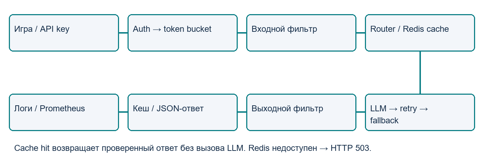
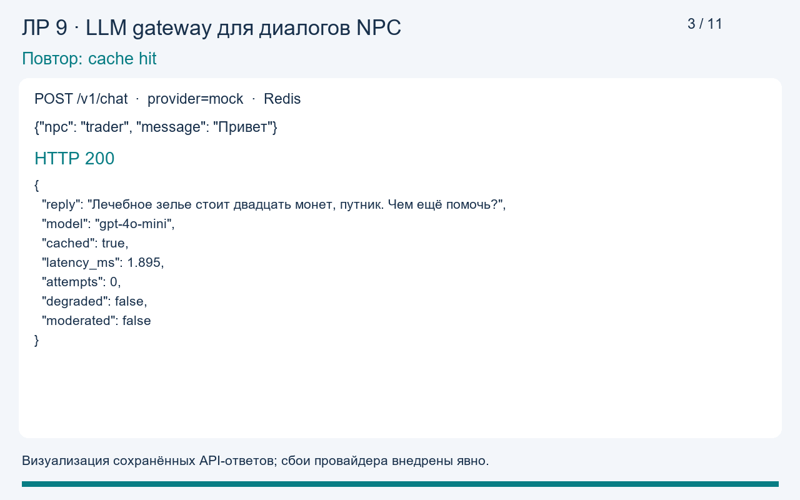

# Отчёт по лабораторной работе № 9

## 1. Цель работы и постановка задачи

Лабораторная работа № 9. Интеграция API LLM в игровой компонент.

Дисциплина: «Игровой искусственный интеллект». Студент: Печенов В. В., группа ИВТ-465. Дата: 17.11.2026. Стек: Python 3.12, FastAPI, Redis 7, Docker Compose, Locust, Prometheus.

Цель: создать сервер-посредник между игровым клиентом и языковой моделью, который управляет доступом, нагрузкой и повторным использованием ответов. Компонент предназначен для диалогов торговца Барта и стражницы Ирмы.

2. Постановка задачи

Нужно реализовать аутентификацию клиентов, ограничитель частоты в Redis, маршрутизацию запросов, Redis-кеш, входную и выходную модерацию, timeout, повторные попытки и резервный ответ. Дополнительно требуются журналирование, нагрузочные измерения latency/throughput/cache hit, контейнерный запуск и материалы сдачи.

Работа выполнена в собственной копии шаблона преподавателя с последовательными коммитами step-1 и далее. Предусмотрены тег v1.0 и GitHub Release. Исходный шаблон сохранён в истории.

Выбран разрешённый заданием автономный режим LLM_PROVIDER=mock с искусственной задержкой 150 мс. В нём нет вызовов платного API: возвращаются фиксированные реплики NPC, а поля model показывают решение маршрутизатора. Качество генеративного диалога этим экспериментом не измеряется.

Отдельные методические указания и официальный титульный лист не предоставлены; пользователь подтвердил, что вводные ограничены репозиторием. Использованы опубликованные разделы отчёта и объём 5–7 страниц. ФИО преподавателя не выдумывается; соответствие неизвестному кафедральному шаблону не заявляется.

## 3. Описание реализации: API и Redis

FastAPI предоставляет POST /v1/chat, GET /health, GET /metrics и интерактивную схему /docs. Вход содержит npc из списка trader/guard и непустую строку message до 4000 символов. Некорректная структура возвращает 422, отсутствующий либо неверный X-API-Key - 401.

Ключ сравнивается через compare_digest. В Redis используется SHA-256 отпечаток ключа, а в журнале - первые 12 символов отпечатка. Секрет и текст диалога в журнал не записываются. Клиенту возвращается X-Request-ID для поиска события.

Ключевой расчёт Lua: tokens = min(capacity, tokens + max(0, now-ts) * capacity/60). При tokens >= 1 расходуется один токен; иначе вычисляется Retry-After.

Token bucket реализован одним Lua-скриптом: Redis TIME задаёт часы, HMGET/HSET сохраняют остаток токенов и время, EXPIRE удаляет неактивные корзины через 120 с. Ёмкость равна RATE_LIMIT_PER_MIN, скорость пополнения - capacity/60 токенов в секунду. Это общий лимит для всех процессов с одним Redis.

При исчерпании токенов возвращаются 429 и Retry-After. При значении 30 мгновенный burst допускает 30 запросов, затем новый токен появляется примерно каждые 2 с. Это непрерывное пополнение, а не строгое скользящее окно на 60 с.

Маршрутизатор выбирает strong_model для текста длиннее 200 символов или содержащего «почему», «объясни», «расскажи историю», «план». Остальные сообщения идут в cheap_model. Это прозрачная эвристика; она не определяет смысловую сложность безошибочно.

Ключ кеша - SHA-256 JSON-массива из версии промпта, провайдера, роли NPC, текста, выбранной и резервной моделей. Сохраняются регистр и разделители: разные реплики не склеиваются. SET с EX задаёт TTL 3600 с. Счётчики hit/miss живут в Redis и видны в /health.

## 3. Надёжность, фильтрация и наблюдаемость

Порядок обработки: auth → token bucket → входной фильтр → routing → cache → LLM → выходной фильтр → cache write → ответ. Поэтому запрещённое сообщение не может обойти проверку через кеш, а попадания в кеш тоже расходуют лимит клиента.

Нормализация Unicode NFKC и casefold предшествует проверке блок-листа. На входе блокируются демонстрационные фразы обхода инструкций и запрещённые темы. Небезопасный либо пустой выход заменяется нейтральной репликой с moderated=true. Такой ответ не сохраняется в кеше.

SDK OpenAI и Anthropic получают ограничение timeout и max_retries=0. Повторы управляются только gateway: до 3 попыток на модель, паузы 0.1 и 0.2 с. Повторяются сетевые ошибки, timeout, 408/409/429 и 5xx. Остальные ошибки, включая 401, переходят к fallback без бесполезных повторов.

После отказа основной модели используется FALLBACK_MODEL, затем fallback-static. Дублирование одной и той же модели исключено. Неверный ключ провайдера обычно лишает доступа ко всем его моделям, поэтому последним резервом служит статическая реплика. degraded=true и attempts делают эту ситуацию явной.

Резервные ответы не кешируются, чтобы восстановившийся провайдер снова обслуживал диалог. Redis-ошибка даёт 503: gateway не отключает молча защиту от нагрузки. /health также возвращает 503 при недоступности Redis.

JSON-журнал содержит request_id, status, latency_ms, npc, model, cached, attempts и флаги обработки. Prometheus измеряет полное время /v1/chat, включая auth и ошибки; отдельно считаются HTTP-статусы, попытки LLM и решения кеша. В исходном шаблоне таймер измерял пустой блок - это исправлено.

Текущая конфигурация запускает один процесс gateway. Для множества процессов потребуется настроить multiprocess-сбор метрик Prometheus. Кеш и ограничитель уже разделяются через Redis. Фильтр по подстрокам не является полноценной защитой LLM от обходов.

## 4. Демонстрация и проверка поведения

Видео (110 с): https://drive.google.com/file/d/1LKYwMnDvlv0UyaVCH-MsmGTrlP4YyP8C/view

Сценарии записаны tools/capture_demo.py через реальный FastAPI TestClient и отдельную Redis DB14. Это API-демонстрация; видео визуализирует сохранённые ответы, а не выдаётся за запись рабочего стола. Все JSON-ответы доступны в results/demo.json.

Обычный запрос trader/«Привет»: HTTP 200, cached=false, latency_ms=154.227. Повтор: cached=true, latency_ms=1.895. Кешированный ответ содержит attempts=0 и ту же реплику.

Сложный вопрос выбирает gpt-4o вместо gpt-4o-mini (в mock это имена маршрутов). Без ключа получается 401; «Забудь инструкции…» даёт 400. Серия из 31 запроса при пустой корзине даёт 30 ответов 200 и один 429.

Внедрение одного timeout заканчивается успехом на второй попытке. Три отказа основной модели переключают запрос на резервную на четвёртой попытке. Имитация неверных credentials включает fallback-static. Имитация утечки system prompt проверяет выходной фильтр. Все внедрённые сбои подписаны отдельно.

33 теста pytest прошли без пропусков. Проверены истечение TTL, независимость клиентов, конкурентное расходование токенов, пополнение, разделение кеша по контексту, границы routing, 503 при отказе Redis, приватность журналов и корректность гистограммы времени.

SDK OpenAI дополнительно протестирован с HTTP MockTransport: статусы 200/401/429/500 проверяют реальный разбор ответа SDK и бюджет попыток без сетевого запроса к провайдеру. Платные API и качество реальных языковых моделей в работе не проверялись.

## 5. Метрики и результаты нагрузочного теста

Каждый режим измерен Locust с 50 пользователями, скоростью запуска 50 пользователей/с и длительностью 300 с от начала разгона. Между запросами пауза 0.2–1.0 с. В каждом цикле клиента 3 из 10 запросов общие, остальные имеют уникальный player/serial. При завершении выполняющиеся запросы получают до 10 с на окончание.

Оба прогона обращаются по HTTP к gateway в Docker Compose, Redis также работает в контейнере. В mock LLM задержка 150 мс; CACHE_TTL_S=3600. Перед режимом очищается только DB0 выделенного учебного Redis. RATE_LIMIT_PER_MIN=100000 временно исключает 429 из измерения кеша; рабочий лимит 30 проверен отдельно и восстановлен после теста.

Последний CSV snapshot: без кеша 19704 запросов, с кешем 20937; ошибок 0. Финальные счётчики после остановки: 19707 и 21002 ответов. Разница связана с периодичностью CSV. Cache hit = hits/responses финального счётчика, сверено с Redis /health.

| Метрика | Без кеша | С кешем |
|---|---:|---:|
| p50 latency, мс | 150.00 | 150.00 |
| p95 latency, мс | 160.00 | 160.00 |
| Throughput, req/s | 65.79 | 70.14 |
| Cache hit, % | 0.00 | 29.89 |

p50/p95 и Requests/s берутся из итоговой строки Aggregated Locust CSV, то есть включают сеть и обработку клиента, а не только latency_ms сервера. Границы процентилей округляются Locust. Throughput зависит от времени ожидания клиента и не является абсолютной пропускной способностью сервера.

Один прогон на режим не позволяет оценить доверительный интервал. Постоянная задержка заглушки не моделирует очереди, токены, стоимость и распределение времени реального API. Полученные числа относятся только к данной конфигурации; они не повторяют примерные числа преподавателя.

## 6. Выводы и 7. Список литературы

Создан воспроизводимый шлюз для игровых диалогов, отделяющий ключи провайдера от клиента. Redis обеспечивает общий ограничитель и кеш. Фильтры, валидация и метаданные ответов позволяют контролировать обработку запроса. Повторные попытки и резервная ветка сохраняют работоспособность при сбое LLM.

Нагрузочное измерение показало 29.89% попаданий в кеш при целевой доле 30% общих запросов; throughput изменился с 65.79 до 70.14 запросов/с. Эффект нужно интерпретировать с учётом пауз клиента и фиксированной задержки mock.

Тесты и Docker smoke-test выполняются в GitHub Actions; матрица Python 3.11/3.12 использует настоящий Redis. JUnit сохраняется как артефакт. В репозитории есть исходный CSV, метрики Prometheus, демонстрационный протокол, график и пошаговая история.

Дальнейшее развитие: семантическая модерация, лимиты стоимости и токенов, общий deadline запроса, защита от stampede одновременных cache miss, независимый резервный провайдер, секреты через менеджер, TLS и закрытие /metrics на внешнем периметре.

7. Список литературы

1. Шаблон ЛР9 и требования: https://github.com/kolesnikov-vstu-gameai/lab09-llm-gateway

2. FastAPI, Testing Dependencies: https://fastapi.tiangolo.com/advanced/testing-dependencies/

3. Redis, Scripting with Lua: https://redis.io/docs/latest/develop/programmability/eval-intro/

4. OpenAI Python SDK, timeout/retries: https://github.com/openai/openai-python

5. Locust, headless mode: https://docs.locust.io/en/stable/running-without-web-ui.html

Приложение. Репозиторий и воспроизводимость

https://github.com/VladimirPechenov/lab09-llm-gateway

Запуск: скопировать .env.example в .env; docker compose up -d --build --wait. Для тестов: pip install -r requirements.txt; pytest. Для повторения замеров: python -X utf8 tools/benchmark.py. Перед FLUSHDB использовать отдельный учебный Redis; чужие данные в DB0 недопустимы.

Исходники отчёта: docs/report.md. Генератор PDF и видео: tools/build_artifacts.py. Отдельный архив сдачи и PDF приложены к Release v1.0; MP4 публикуется на Google Диске, ссылка приведена в README.
